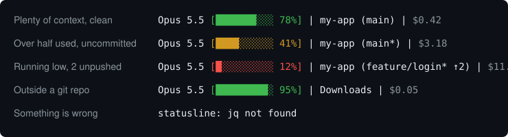

# claude-statusline

A single-file [Claude Code](https://claude.com/claude-code) status line:



- **Model** — display name, with the `(1M context)` suffix trimmed.
- **Context gauge** — a bar showing context *remaining* (it drains as the window
  fills), plus the percentage. Green > 50% left, yellow > 20%, red below.
  Uses Claude Code's own `context_window.remaining_percentage`; before the
  first reply it estimates from the transcript (1M for `[1m]` models, 200k
  otherwise).
- **Location** — repo name (its top-level folder, even from a subfolder) and
  current git branch. `*` means uncommitted changes (including untracked
  files); `↑2` means two local commits not yet pushed. Both are local checks;
  it never fetches.
- **Cost** — at the end, muted: the session's running cost (`$1.23`). This is
  Claude Code's own estimate at API prices (`cost.total_cost_usd`); on a
  Pro/Max plan it's what the session *would* cost, not what you're billed.
  Hidden if your Claude Code version doesn't send it.

Purely presentational — it reads the status-line JSON on stdin and prints one
line. It shows Claude Code's cost estimate but doesn't track or store anything:
no network, no state.

If something is wrong it says so instead of showing a misleading gauge:
`statusline: jq not found` or `statusline: could not parse input`.

## Requirements

- `jq` — included with macOS 15 and later. The script finds it in
  `/opt/homebrew/bin`, `/usr/local/bin` or `/usr/bin` even when Claude Code
  runs it with a minimal `PATH`.
- `git` (branch display degrades to just the repo name if unavailable)

## Install

If `jq --version` fails, install it first:

```sh
brew install jq
```

Then run:

```sh
./install.sh
```

This symlinks `statusline.sh` into `~/.claude/` and prints the `settings.json`
snippet to add. It does not edit `settings.json` for you.

## Manual install

Copy or symlink `statusline.sh` somewhere, then point Claude Code at it in
`~/.claude/settings.json`:

```json
{
  "statusLine": {
    "type": "command",
    "command": "bash \"$HOME/.claude/statusline.sh\""
  }
}
```

## Tests

```sh
./test.sh
```

Covers the context gauge (thresholds, transcript fallback), cost formatting,
the error messages
and each git state, using throwaway repos in a temp dir.

The README picture is rendered from the script's real output. After changing
how the line looks, run `docs/render.sh` to refresh `docs/states.svg`.
